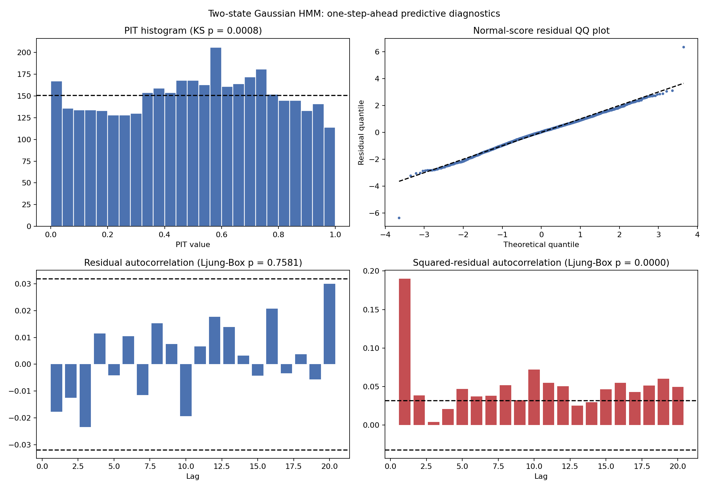
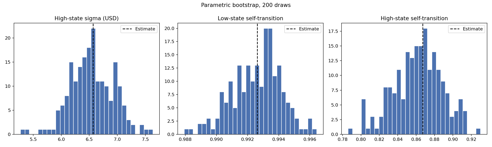
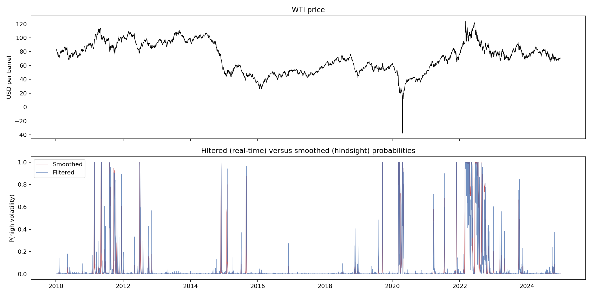

# Gaussian Diagnostics Result

Run date: 1 September 2026

## Method

The two-state Gaussian model fitted on 11 August 2026 was refitted from the
frozen data and matched the recorded parameters to within `1e-8`. Four checks
were then run on that fit. Script: `05_gaussian_diagnostics.py`. Gate
definitions: `GATES.md`, gate G6.

All predictive diagnostics use filtered probabilities. Each observation is
scored against the one-step-ahead predictive distribution built from data up
to the previous day only.

## 1. Does the Markov structure matter?

| Model | Parameters | Log-likelihood | BIC |
|---|---:|---:|---:|
| Two-state Gaussian HMM | 7 | -6,771.38 | 13,600.40 |
| Two-component Gaussian mixture, no persistence | 5 | -6,843.67 | 13,728.52 |

The likelihood-ratio statistic is 144.6 on two extra parameters. The HMM has
the lower BIC by 128 units. Gate G6.1 passes: the data support persistent
states rather than independent draws from a mixture.

## 2. Are the predictive distributions adequate?

| Test | Statistic | p-value | Gate G6 threshold | Result |
|---|---:|---:|---:|---|
| Kolmogorov-Smirnov, PIT uniform | 0.0323 | 0.0008 | 0.01 | Fail |
| Ljung-Box(20), normal-score residuals | 15.3 | 0.758 | 0.01 | Pass |
| Ljung-Box(20), squared residuals | 282.8 | < 1e-40 | 0.01 | Fail |

Residual moments: mean -0.000, standard deviation 0.974, skewness -0.17,
excess kurtosis 0.97.



Reading: there is no linear predictability left in the residuals. There is
strong remaining volatility clustering. Two Gaussian states do not capture
the dependence in squared moves. The residual excess kurtosis of 0.97 shows
the predictive tails are still too thin. Both soft tests fail and are recorded
as limitations of the reference model.

## 3. How uncertain are the parameters?

Parametric bootstrap, 200 draws of 3,770 observations each, refitted from the
deterministic start.

| State | Parameter | Estimate | Standard error | 95% interval |
|---|---|---:|---:|---|
| Low volatility | Mean | +$0.013 | $0.021 | -$0.025 to +$0.050 |
| Low volatility | Sigma | $1.291 | $0.014 | $1.262 to $1.314 |
| Low volatility | Self-transition | 0.9926 | 0.0016 | 0.9893 to 0.9956 |
| High volatility | Mean | -$0.293 | $0.497 | -$1.296 to +$0.584 |
| High volatility | Sigma | $6.567 | $0.389 | $5.892 to $7.283 |
| High volatility | Self-transition | 0.8672 | 0.0266 | 0.8030 to 0.9108 |



Reading: neither state mean is distinguishable from zero. The negative
high-state mean in the point estimate must not be interpreted as a drift. The
volatility and persistence parameters are estimated precisely under the
model's own assumptions. The bootstrap assumes the model is correct, so these
intervals are lower bounds on the true uncertainty.

## 4. Durations, roll windows and real-time lag

| State | Episodes | Realised mean | Realised median | Geometric expectation | Ratio |
|---|---:|---:|---:|---:|---:|
| Low volatility | 17 | 211.2 days | 60 days | 135.5 days | 1.56 |
| High volatility | 16 | 11.3 days | 7 days | 7.5 days | 1.49 |

Viterbi episodes are about 50% longer than the geometric expectation in both
states. This is expected: Viterbi smooths over short excursions, so realised
episodes are longer than the transition matrix implies for the raw state
process. It does not by itself reject the geometric assumption.

Roll window. 26.7% of high-state dates fall on calendar days 14 to 23, against
33.0% of all dates. Chi-square p-value 0.077. There is no evidence that the
high-volatility state is a contract-roll artefact. The calendar screen is
still not a substitute for contract-level roll dates.

Real-time lag. Classifying each day by the filtered probability disagrees with
the hindsight Viterbi path on 2.4% of dates, against 0.5% for the smoothed
probability. Filtered high-state occupancy is 4.2% against 4.8% under Viterbi.



## Research consequence

The reference model is worth improving, not discarding. Persistence is real.
The two failures point in one direction: the predictive distribution needs
heavier tails and more volatility dependence. Student-t emissions address the
tails; a third state addresses the dependence. Both are tested in
`06_model_comparison.py` under the same gates.

## Reproduction

```bash
python 05_gaussian_diagnostics.py
```

Outputs are in `outputs/gaussian_diagnostics`.
