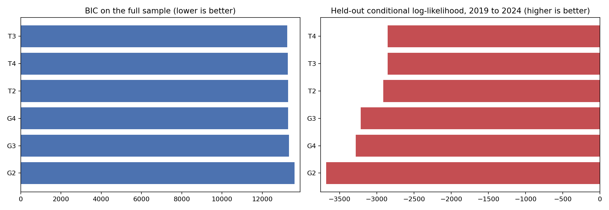
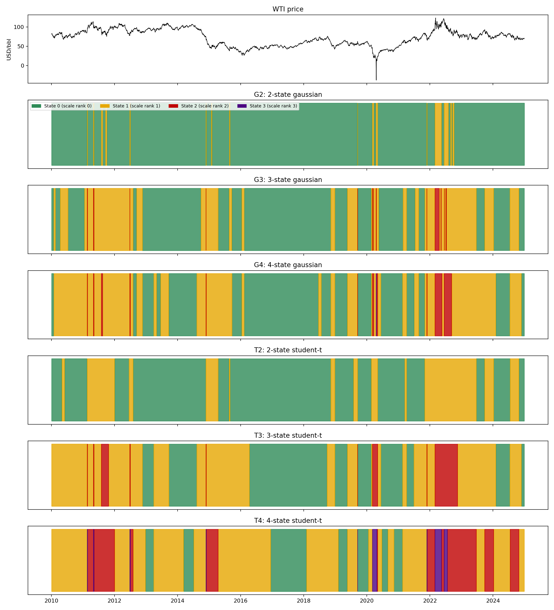
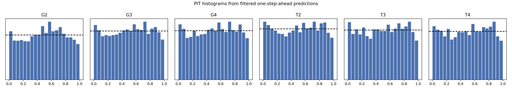

# Model Comparison Result

Run date: 1 September 2026

## Method

Six candidates were fitted to the same 3,770 daily WTI price changes and
passed through the gates registered in `GATES.md` before any result was read.
Script: `06_model_comparison.py`.

| Candidate | States | Emission | Free parameters |
|---|---:|---|---:|
| G2 (reference) | 2 | Gaussian | 7 |
| G3 | 3 | Gaussian | 14 |
| G4 | 4 | Gaussian | 23 |
| T2 | 2 | Student-t | 9 |
| T3 | 3 | Student-t | 17 |
| T4 | 4 | Student-t | 27 |

Every fit uses the multi-start estimator: one deterministic start plus random
starts with fixed seeds, keeping the best likelihood. Full sample: 12 starts.
Each G4 subsample: 8 starts. Training sample for held-out scoring: 8 starts.

## Selection table

| Candidate | Log-likelihood | BIC | Held-out log-lik 2019 to 2024 | Held-out excl. 20 and 21 Apr 2020 | Smallest state occupancy | G3 | G4 | G5 |
|---|---:|---:|---:|---:|---:|---|---|---|
| G2 | -6,771.4 | 13,600.4 | -3,680.7 | -2,898.7 | 4.8% | Pass | Fail | Reference |
| G3 | -6,602.9 | 13,321.0 | -3,215.4 | -2,822.6 | 1.7% | Pass | Fail | Fail |
| G4 | -6,546.0 | 13,281.3 | -3,281.6 | -2,826.8 | 0.05% | Fail | Fail | Fail |
| **T2** | -6,603.5 | 13,281.1 | -2,911.6 | -2,863.6 | 27.9% | Pass | **Pass** | **Pass** |
| T3 | -6,550.5 | 13,240.9 | -2,855.5 | -2,813.1 | 8.1% | Pass | Fail | Fail |
| T4 | -6,525.1 | 13,272.5 | -2,854.8 | -2,812.2 | 3.6% | Fail | Fail | Fail |



## Gate detail

G3, initialisation stability. G2, G3, T2 and T3 converge to one solution from
at least 11 of 12 starts with identical Viterbi paths. G4 and T4 do not: with
four states the likelihood surface has several local optima and the state
paths differ between starts.

G4, sample stability. Minimum Viterbi agreement with the full-sample fit
across the three subsamples, and the largest shift in top-state occupancy:

| Candidate | Minimum agreement | Largest occupancy shift | Threshold |
|---|---:|---:|---|
| G2 | 81.8% | 18.2 pp | 90%, 5 pp |
| G3 | 68.3% | 2.5 pp | |
| G4 | 51.5% | 2.9 pp | |
| T2 | 98.3% | 1.7 pp | |
| T3 | 66.9% | 13.1 pp | |
| T4 | 10.4% | 20.2 pp | |

T2 subsample detail:

| Sample | Agreement with full fit | Low scale | High scale | Low nu | High nu |
|---|---:|---:|---:|---:|---:|
| 2010 to 2016 | 98.3% | $1.13 | $1.67 | 29.5 | 7.3 |
| 2017 to 2024 | 99.5% | $0.89 | $1.78 | 8.9 | 3.7 |
| Without 20 and 21 April 2020 | 99.8% | $1.01 | $1.80 | 14.7 | 5.7 |

Removing the two cross-zero days changes the T2 state path on 0.2% of dates.
The same removal changed the Gaussian path on 18.2% of dates.

G6, persistence. Every candidate beats its independent-mixture counterpart
on BIC. The Markov structure is supported throughout.

## Selected model: two-state Student-t (T2)

T2 is the only candidate that passes every gate. T3 has a lower BIC and a
higher held-out log-likelihood, but its state path depends on the fitted
period: agreement falls to 66.9% on the 2010 to 2016 subsample and its
smallest state changes occupancy by 13 percentage points. Under G5 a
candidate that fails G4 cannot be selected, whatever its fit statistics.

| Property | Low volatility | High volatility |
|---|---:|---:|
| Mean daily change | +$0.051 | -$0.025 |
| Scale | $1.017 | $1.739 |
| Degrees of freedom | 14.5 | 4.2 |
| Implied standard deviation | $1.095 | $2.391 |
| Self-transition | 0.9916 | 0.9815 |
| Expected duration | 119 days | 54 days |
| Viterbi occupancy | 72.1% | 27.9% |

The high-volatility state is a different object from the Gaussian one. The
Gaussian model built a narrow state around extreme days: 4.8% occupancy, a
$6.57 daily standard deviation and a 7.5-day expected duration. The Student-t
model absorbs those days in its tails (degrees of freedom 4.2) and finds a
broad, persistent volatile state covering 28% of the sample with an expected
duration of 54 days.

Longest high-volatility episodes under T2:

| Start | End | Trading days |
|---|---|---:|
| 3 November 2021 | 22 June 2023 | 410 |
| 22 February 2011 | 3 January 2012 | 219 |
| 28 November 2014 | 15 April 2015 | 94 |
| 27 September 2023 | 8 January 2024 | 71 |
| 19 July 2024 | 28 October 2024 | 71 |
| 24 February 2020 | 5 May 2020 | 51 |

These are statistical classifications. They coincide with well-known
periods of market stress, but the model does not identify causes.



## Adequacy of the selected model

| Test | G2 | T2 | Threshold |
|---|---:|---:|---|
| PIT uniformity, KS p-value | 0.0008 | 0.344 | 0.01 |
| Ljung-Box(20) residuals, p-value | 0.758 | 0.835 | 0.01 |
| Ljung-Box(20) squared residuals, p-value | < 1e-40 | < 1e-20 | 0.01 |
| Residual excess kurtosis | 0.97 | 0.04 | |



The Student-t tails fix the predictive distribution's shape: PIT values are
uniform and the residual kurtosis is gone. Volatility clustering remains.
Squared residuals are still autocorrelated, so two persistent states do not
capture all the time variation in volatility. This is recorded as a
limitation under G6.3. The three-state Student-t model reduces it (p = 0.034)
but fails sample stability.

## What the held-out numbers say

T2's held-out advantage over G2 is 769 log-likelihood units on the 2019 to
2024 test sample, but 35 units when the two cross-zero days are excluded.
Most of the advantage is the Gaussian model's failure on two dates. On the
remaining 1,505 test days, G3 and T3 score better than T2 by 41 and 50
units. Both fail G4, so the pre-registered rule keeps T2. This is the trade
that G5 makes on purpose: a stable model over a better-fitting unstable one.

## Bootstrap standard errors for the selected model

Parametric bootstrap, 100 draws of 3,770 observations, multi-start refits.

| State | Parameter | Estimate | Standard error | 95% interval |
|---|---|---:|---:|---|
| Low volatility | Mean | +$0.051 | $0.020 | +$0.009 to +$0.093 |
| Low volatility | Scale | $1.017 | $0.026 | $0.966 to $1.057 |
| Low volatility | Degrees of freedom | 14.5 | 8.1 | 8.4 to 39.1 |
| Low volatility | Self-transition | 0.9916 | 0.0021 | 0.9877 to 0.9952 |
| High volatility | Mean | -$0.025 | $0.064 | -$0.151 to +$0.087 |
| High volatility | Scale | $1.739 | $0.064 | $1.625 to $1.879 |
| High volatility | Degrees of freedom | 4.25 | 0.62 | 3.51 to 5.86 |
| High volatility | Self-transition | 0.9815 | 0.0049 | 0.9723 to 0.9890 |

The high-state mean is indistinguishable from zero. The low-state mean is
small and marginally positive, about 2.5 standard errors from zero; it is
not a trading claim. The low-state degrees of freedom are poorly identified:
the interval runs from 8 to 39, so that state is close to Gaussian and the
data cannot say how close. The high-state tail index is tight at about 4.
The bootstrap assumes the model is correct, so these intervals are lower
bounds on the true uncertainty.

## Limitations

- Two states leave volatility clustering in the residuals.
- Dollar price changes are not scale-free (asinh candidate tested 8 October
  2026, failed G4; `SCALE_FREE_RESULT.md`). The low-scale estimate is $1.13
  on 2010 to 2016 and $0.89 on 2017 to 2024.
- Low-state degrees of freedom are weakly identified (interval 8 to 39).
- The 2025 to 2026 holdout remains sealed. No candidate has seen it.
- Roll days do not drive the state path (8 October 2026 check below).

## Roll-day check, 8 October 2026

Registered in the `GATES.md` change log before any fit: a fourth G4
subsample, the full sample without the day after each CL expiry (180 roll
days, rule in `roll_dates.py`). It is a record only and cannot change the
selection. Every candidate was refitted on 8 October 2026 with the same
seeds. Every earlier figure in this document came back unchanged.

| Candidate | Viterbi agreement with the full fit | Top-state occupancy shift | Record pass |
|---|---:|---:|---|
| G2 | 99.3% | -0.7 points | Yes |
| G3 | 94.5% | 0.0 points | Yes |
| G4 | 98.8% | 0.0 points | Yes |
| T2 | 96.2% | -2.0 points | Yes |
| T3 | 94.2% | 0.0 points | Yes |
| T4 | 98.2% | -0.3 points | Yes |

Thresholds: agreement at least 90%, shift within 5 points.

T2 does not depend on roll days. Without them its states keep their shape:
low-state implied standard deviation $1.11 (full fit $1.09), high-state
$2.45 ($2.39), self-transitions 0.992 and 0.981 (0.992 and 0.982). The
low-state degrees of freedom move from 14.5 to 11.4, inside the bootstrap
interval of 8 to 39. Roll days are not why the model finds two regimes.
The roll limitation in the trading project stays a P&L question, not a
regime question.

## Reproduction

```bash
python 06_model_comparison.py
python 07_selected_model_bootstrap.py
```

Outputs are in `outputs/model_comparison`. The full run takes about 30
minutes.
